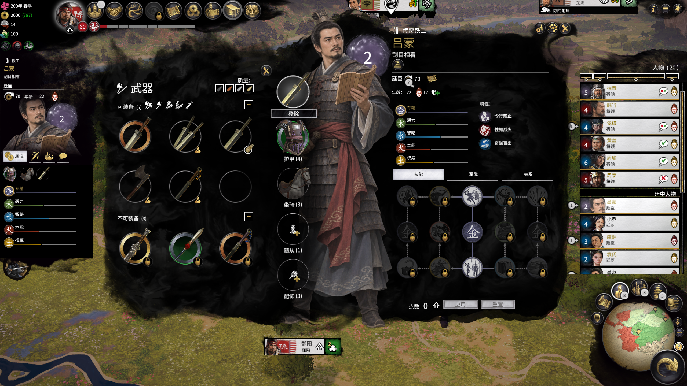
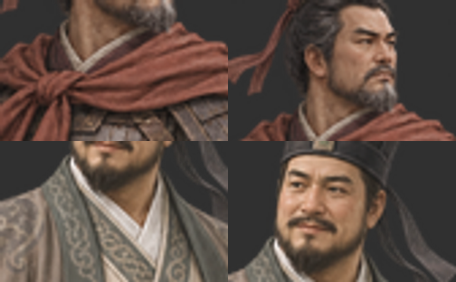

# 全面战争：三国 · 独立立绘实验补丁

面向《全面战争：三国》原版与 MTU 3.3 的立绘实验。公开代码、AI 原画、失败记录与换机方法，方便继续研究；**不是完成版，也不是已经全面验证兼容的 27 人正式 Mod。**

截至 2026-11-08：图片加载方案已有局部游戏实测；原画风格多次调整后仍未达到与原版统一的要求，暂时停止画风迭代并公开现状。专属护甲没有制作。

## 当前状态

| 项目 | 已完成/证据 | 尚未完成 |
|---|---|---|
| 27 人原画 | 16 男 + 11 女 PNG；人物模板映射 | 多数尚未适配修复后的加载结构 |
| 吕蒙 | 最新用户截图确认全身、左侧半身、府署/人物列表头像出现 | 其他界面、换装备、不同存档完整回归 |
| 韩当 | 府署半身及修正版列表头像有截图 | 全身详情的本轮验收 |
| 鲁肃 | 府署半身有截图；头像修正已构建 | 修正后头像没有最新截图确认 |
| MTU | 本机 MTU 3.3 同开测试三人，有局部截图 | 所有角色、装备和版本兼容 |
| 原版单独使用 | 单独绑定包可构建，静态读取/写入验证 | 本轮完整游戏实测 |
| 大集结 | 此前静态检查未发现目标路径/键交集 | 不等于战役兼容通过，未完成联合游戏验证 |
| 专属装备 | 核对了程普/黄盖初始护甲及外观映射 | 吕蒙等仍用通用装备，立绘衣甲与装备不匹配 |
| 画风 | 原稿及吕蒙 v2–v5 样稿保留 | 用户仍认为过于写实；第三版又过度扁平化，均未定稿 |

**重要：当前构建保留旧的 27 人实验底包，再叠加鲁肃、韩当、吕蒙三人修复。其余 24 人可能空白、无头或裁切异常。不要当作可全面使用的正式版。**

- [安装与换电脑恢复](docs/INSTALL.md)
- [问题、原因、修复与验证完整记录](docs/TROUBLESHOOTING.md)
- [结构、原始数据与参考来源](docs/ARCHITECTURE.md)
- [许可证与素材边界](docs/LICENSING.md)
- [人物名单及遗漏](docs/CHARACTERS.md)

## 快速开始

准备自己合法安装的游戏、Steam 订阅的 MTU 3.3、Python 3.11+、Node.js 22+ 和 7-Zip。
当前本机验证环境为 Windows、Python 3.14、Node 24.18、sharp 0.35.5、游戏 1.7.2.0。

```powershell
git clone https://github.com/ZedekiahS/three-kingdoms-portrait-mod.git
cd three-kingdoms-portrait-mod
npm ci
python tools/rebuild.py --game-data "D:/SteamLibrary/steamapps/common/Total War THREE KINGDOMS/data" --workshop "D:/SteamLibrary/steamapps/workshop/content/779340" --sevenzip "C:/Program Files/7-Zip/7z.exe"
```

将路径换成实际位置。输出在 `dist/`，不会自动安装或启动游戏。该重建入口目前要求 MTU 本地包存在，以同时生成两个绑定配置；想玩原版时，只安装原版绑定包。安装组合详见安装文档。

本仓库不包含游戏、MTU、大集结、淝水之后、甲申的原始包、完整解包表、原画或 CEO 数据。生成的绑定包含有本机开局数据，因此默认不提交，也不作为独立素材重新授权。

## 关键截图

吕蒙局部验收截图（并不证明整个 Mod 完成）：



原版裁切区域复现：左旧、右修正；上韩当、下鲁肃。



代码和文档采用 MIT；AI 原画的开放使用说明及第三方许可见许可证文档。欢迎研究、修改、分支继续；请保留“实验版”的验证边界。
