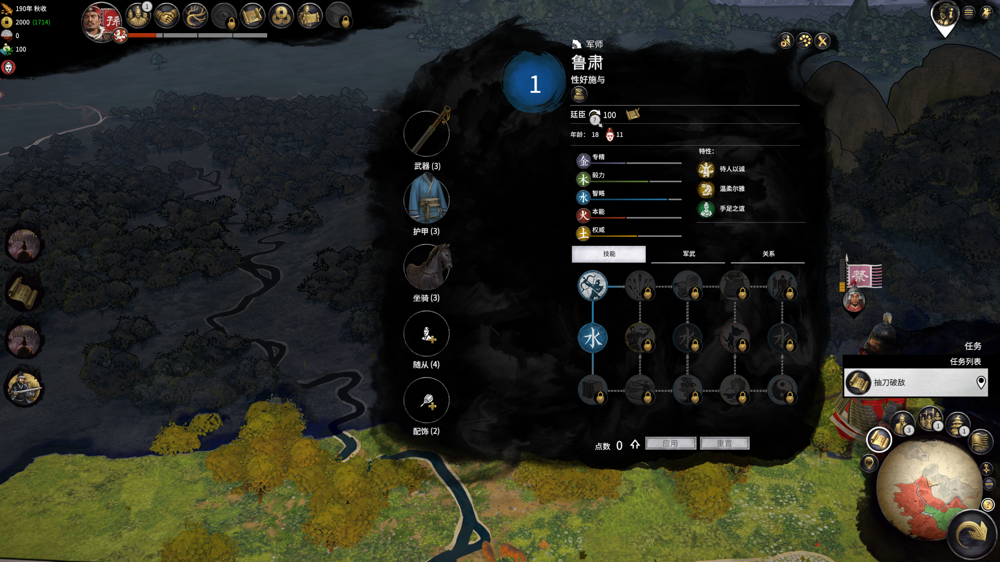
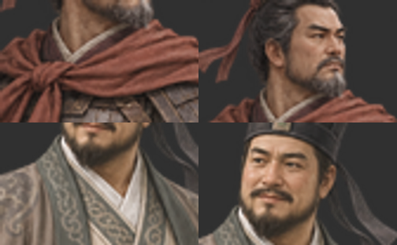

# 立绘故障完整复盘

本文记录实际发生的错误、修复依据和证据边界。目标是换电脑或继续开发时避免重复试错。代码“运行成功”不等于游戏加载正确；本文保留失败方案，而不是将每一版都描述成成功。

## 1. 第一原则：先追完整加载链

先查目标人物的实际模板、初始数据、美术集和图片路径，再选择参考人物。不能只因为 MTU 蔡琰有独立整图，就把一个原版泛型渲染的人物也按相同目录输出。

主要链路：

```text
character_generation_templates.art_set_override
  -> campaign_character_art_sets.art_set_id
  -> campaign_character_arts（年龄/成年记录）
  -> portrait 目录 + card/脸部编号 + 装备外观
  -> composites（全身/面板）或 stills（不同头像）
```

已存在的战役人物还有 startpos/存档里的美术集引用；装备初始化、权限、称号、3D 外观有自己的数据链，不能与二维立绘混为一谈。

## 2. 旧身体/旧头像叠在新人物上

**现象：** 韩当出现新图与旧头像叠加、旧护甲残留；不同页面表现不同。

**最初的错误：** 自己的图放进了一个目录，但没有完整控制游戏会组合的脸部、装备及回退层；早期 PNG 定位信息也不完整。

**查明：** 鲁肃、韩当、吕蒙有特殊称号，但仍走通用人物“脸部 + 装备”路径。游戏可以在缺失资源时回退找原版装备，缺文件并不等于不画。

**修复：** 将完整人物图放到此人的私有 `composites/faces/<card>/...`，在私有目录为实际可能读取的装备路径提供透明占位。各类 stills 也放入 faces，并补对应装备透明图。清空本补丁遗留的直接整图路径，避免同一个人物被画两遍。

没有修改全局 `fire/male` 等目录，因此不会把所有同职业人物一起改掉。透明图是在自己的目录新生成的；不是直接覆盖原版全职业护甲。

**验证：** 枚举真实原版/MTU 资源路径做缺失检查，检查透明替身，PFH5 打包后重新读取；最终仍需截图。吕蒙最新详情图可看到完整人物，未见旧身体叠加。

## 3. 0.2 改成整图后，鲁肃全身空白

**现象：** 头像或部分 UI 仍在，但人物详情全身区域空白。

**错误修复：** 仿照独立角色的直接 `composites/large_panel/norm/noanim.png` 路线，移除了 faces，误把“有独立美术编号”当成“渲染方式已经改为独立整图”。

**为何静态测试没拦住：** `check_portrait_contract.py` 校验的是当时选错的 MTU noanim 布局，甚至将 faces 判为不兼容。它可以全绿，却没有验证目标人物实际走的路径。这是错误的测试假设，不是游戏已通过。

**正确处理：** 查目标人物实际数据，回到泛型脸部/装备结构。这个旧检查只保留为历史导出中间步骤，不能当最终验收。最终需要 `generic_route_probe.py` 的实际路径校验及截图。

旧底包对鲁肃/韩当的目标路径分别缺 136/208 项；两人修复后为 0。后来吕蒙同类检查缺 208 项，加入后为 0。数字取决于当时本机枚举的装备资源，不是固定游戏规范。

失败截图：



## 4. 府署头像只有衣领或半张脸

**现象：** 韩当左侧半身已出现，右侧列表只有衣服；鲁肃右侧只剩下半张脸。说明路径已经起作用，但布局不对。

**排查顺序：** 核对 used_mods -> 检查导出图本身有脸 -> 对照原版 PNG -> 读原版 UI 使用哪个头像类别以及偏移。不能把任何小头像都当成居中裁切的正方形。

**直接依据：** 原版 `court_screen_info_lists.twui.xml` 的 portrait 读取 `bobbleheads`，画布 84×138，人物列表纵向偏移约 -61。标准/large 资源要用原版实际尺寸：84×138 和 134×220；不要统一四舍五入推算成 134×221。

旧导出把韩当、鲁肃眼睛分别放在画布 y≈43.8、49.76，落在可视范围上方。文件有脸，显示窗口却裁不到脸。吕蒙旧导出同样 y≈45.15。

**修复：** 读取原版对应 face 图的非透明区域，将自己的脸按该位置缩放排版，保留外围透明画布。改动的是图片布局，没有改游戏 UI。标准/large 分别导出。

`fix_bobbleheads.cjs --check-old` 会对这个旧布局给出 FAIL；新导出检查眼部是否进入原版裁切范围，并输出同区域的前后预览。该检查使用人工指定的人脸特征点，只能验证位置，不能自动判断人物美术质量。



**游戏结果：** 韩当、吕蒙修正版列表头像有新截图。鲁肃修正版头像尚缺新截图，不能用 15:30 的旧图认定新修复失败或成功。

## 5. PNG 有图但大小、位置错了

全身面板 PNG 的 `tEXt` 中 `Comment` 包含 type、x、y、z-order、pivot_x、pivot_y。缺失或错误坐标可能使人物偏移、裁掉或叠在错误位置。普通图片浏览器显示正常不代表这些引擎字段正确。

本项目保留 large/small、norm/happy/angry 组合。当前表情多复用同一画面，不代表完成了独立表情绘制。写入 Comment 时保留图像像素和其他 PNG chunk，重新计算 CRC。不能套用一个角色的数字并声称适用于所有人；身体比例、画布留白、脚底和头顶仍须游戏截图确认。

## 6. 淝水之后、甲申给了什么参考

直接读取本机 `!rtz_era_384.pack`、`ming1644.pack`，而不是凭宣传图猜测。

- 苻坚：独立模板 -> `rtz384_art_set_fu_jian` -> `rtz_artsets/` + `rtz_fu_jian`；整图在 `composites/faces/rtz_fu_jian/.../noanim.png`。
- 朱慈烺：独立模板 -> `ming_art_set_zhu_cilang` -> `ming_heroes/` + `ming_zhu_cilang`；整图在 `composites/faces/ming_zhu_cilang/.../face.png`。
- 两者都有五类 stills，标准/large 两套；抽查装备层 alpha 最大值为 0，即全透明。它们说明“独立人物”完全可以利用泛型 faces 层承载整个人。

参考的是绑定与分层方法，没有复制发布他们的画作、脚本或整套开局。也不意味着本补丁兼容这两个大修模组；当前目标仍是原版 + MTU。

## 7. 只改模板，开局人物没有变

模板控制生成规则；startpos 中已经存在的人物可能存着原美术集。早期须跟踪 `PERSISTENT_CHARACTER/CHARACTER_ART_SET_INFO`。

`patch_startpos.mjs` 只修改目标人物的固定宽度字符串引用，并追加所需字符串；检查其他原始字节保持不变，再重新解析验证。不要全局字符串替换，也不要把祖先、同姓人物或旧残留模板一起改掉。

压缩开局需要保留 CAAB/LZMA 外壳。复用已有解析器，并针对三国压缩尺寸 marker 0x18 的 uint24 字节序适配。7-Zip 产生有界压缩流，再用本地 wrapper 回写；验证解压大小、LZMA 输出和重新解析结果。不能把能被通用工具解压等同于游戏可加载。

## 8. 装好了但用的不是新包

检查 data 目标文件哈希、启动器勾选、加载排序，以及实际 used_mods。不要只凭“已经复制成功”判断生效。Windows 运行中会锁住包，本项目几次覆盖失败后，均等用户退出，再复制并核对 SHA256。

旧测试包可覆盖相同图片或 startpos，movie 类型还可能自动加载。原机器的 `zz_syc_harem_preview_v2.pack` 就是具体干扰项，已保留备份并改扩展名禁用。换机不应把这些旧实验包一起搬过去。

## 9. 特殊称号、独立立绘、历史人物不是同一件事

表内有 `historical` art_set 名称也可能最终指向通用脸。应分别检查：模板是否存在、称号对应哪个 career、实际图片是不是专属、是否在开局中引用。startpos 引用也不能单独证明某人实际出生/可招募。

吕范“围棋名手”、虞翻“狂直谋臣”有专属称号而没有独立全身立绘；蒋钦“激昂慷慨”使用通用称号，也没有独立全身立绘。三人遗漏已记录，但未制作。

## 10. 立绘显示了，装备却不对应

用户截图真正指出的是：程普、黄盖各有对应护甲，而吕蒙画着固定衣甲，装备栏仍是通用护甲。

本机初始装备数据中：

```text
程普 -> 3k_dlc05_ancilliary_armour_cheng_pu_armour_unique
黄盖 -> 3k_cp01_ancillary_armour_huang_gais_armour_unique
吕蒙 -> 3k_main_ancillary_armour_medium_armour_metal_extraordinary
```

程普、黄盖另有装备外观映射。当前补丁没有新增护甲、图标、效果、权限或3D模型；透明装备层只是阻止旧二维衣甲叠图，不等于专属装备完成。不能为了省事改名一件全局通用护甲，那会影响其他人。

后续需分别做专属物品、对应图标与名称、初始装备、适用/锁定规则，并验证 CEO 与 MTU 的兼容。当前不分发 CEO 替换包，不承诺换装备就自动换立绘。

## 11. 画风多次修改仍未成功

原始 AI 图的皮肤、衣料、金属偏写实；v2 加粗笔触仍像写实图；v3 过度减少层次，面部符号化、甲片像纸板；v4/v5 再参考原版，仍偏精细。

原版是可信体积基础上的选择性手绘，不能简单在“照片细节”和“几块平色”之间切换。尺寸、透明度、锐化和裁切无法解决原画风格。用户最终放弃本轮画风迭代，样稿保留但未安装。

## 12. 兼容与验收不能过度推断

大集结四个已安装包此前静态检查未发现目标路径/键交集，但事件、出生和 startpos 的运行交互未完成验证。原版/MTU绑定不能同时勾选。基于原版开局构建的包不能覆盖 MTU 开局后还声称保留其全部修改。

四位女性（伏寿、夏侯徽、羊徽瑜、孙鲁育）的旧数据还存在男性模板标志；本轮只处理图片，没有改变性别/婚姻逻辑。不能因为放了女性立绘就宣称人物系统完全正确。

## 13. 下一位维护者的验收清单

1. 记录游戏/MTU版本、源码提交、依赖版本、包哈希、used_mods。
2. 从目标人物模板一路追到实际美术目录、card、装备路径。
3. 先复现失败，保留截图；同一人物同一界面对比。
4. 校验 PFH5 回读、PNG元数据、路径完整性、透明装备层。
5. 单独看府署头像、半身、全身、人物卡、地图及其他实际使用界面。
6. 测试需要支持的装备/年龄/新档旧档，不把未测试项写成通过。
7. 最后加入其他 Mod，保留原 UI 与原有人物对照。

截至本次记录，只能确认列出的局部截图结果。不要删除失败证据，也不要把 historical-layout 中间检查的 PASS 当游戏验收结论。
